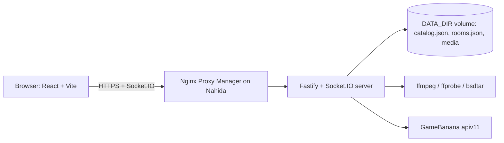

# Multiplayer Choicer Voicer: design and plan

This document is the full plan for the service. It also records the decisions that the code follows.

## 1. Goal

Multiplayer Choicer Voicer is a website for groups of friends. The players dub a Choicer Voicer pack together in the browser. Then they watch the result together, with subtitles, and vote.

The service runs as one Docker container on Nahida, behind Nginx Proxy Manager. It uses the same pattern as Fold Down Stories.

## 2. What a Choicer Voicer pack is

A pack is a folder. The Choicer Voicer Pack Creator writes this layout, and the packs on GameBanana use it too.

```text
My Pack/
├── _pack_info.ini        [data] title, subtitle, icon, authors, readme
├── icon.png              660 x 364 pack icon
├── dub_video.ogv         Theora video + Vorbis audio (the original clip)
├── _backing_track.mp3    music and effects without the voices
├── 001_Speaker.mp3       the original line (the "prompt")
├── 001_Speaker.png       a still frame for the line
├── 001_Speaker.txt       [data] caption, image, dub_timestamps, dub_characters
└── ...
```

The `.ini` and `.txt` files use the Godot `ConfigFile` format. The values are JSON-like literals. A line can have more than one timestamp. In that case, the same recording plays at each timestamp. A line can have more than one character. Captions often start with a `[Character]` tag. The subtitles remove this tag, because they show the character separately.

During the final playback, the game mutes the clip. It plays the backing track and puts each recording at its timestamp. We do the same.

## 3. Pack sources

| Source | How it works |
| --- | --- |
| GameBanana | The server crawls the "Dub Mode" category (category 44064, game 20674) with the public `apiv11` API. It keeps the metadata in `catalog.json`. The library search runs on this local copy, so it is fast. |
| GameBanana link | A player can paste a `gamebanana.com/mods/<id>` link. |
| Direct link | A player can paste a direct archive link. Only hosts on an allow list are accepted (GitHub, Dropbox, Google Drive, Discord CDN, GameBanana). This prevents server-side request forgery into the home network. |
| Upload | A player can upload an archive (`.zip`, `.7z`, `.rar`) or a pack folder. The upload uses resumable 8 MB chunks, so slow connections can continue after an error. |
| Recently used | Packs that the server already processed show in a separate tab. They start immediately. |

The home screen and the "Upload" tab have a "Create your own Choicer Voicer pack" button. It opens [ChoicerVoicerPackCreator](https://github.com/throndir2/ChoicerVoicerPackCreator), a free Windows app that makes a pack from a video or a YouTube link.

The API endpoints that we use:

- `GET /apiv11/Mod/Index?_nPerpage=50&_aFilters[Generic_Category]=44064&_nPage=N` for the list.
- `GET /apiv11/Mod/<id>/ProfilePage` for the files and the description.
- `GET /apiv11/Mod/Categories?_idCategoryRow=44064` for the sub-categories.
- `https://gamebanana.com/dl/<fileId>` for the download.

## 4. Pack processing on the server

Chrome and Safari cannot play Theora video. Also, the still frames are large PNG files. So the server converts each pack one time and keeps the result in a cache.

Processing has two phases, so that players can start to record quickly.

1. **Phase A (fast, seconds).** Download, extract (bsdtar for zip, 7z and rar), find every folder with `_pack_info.ini`, and parse the metadata. Convert the line images to 640 px JPEG files. Copy the prompt MP3 files. Measure each prompt with ffprobe. Write `manifest.json`. The room can start to record after phase A.
2. **Phase B (slow, minutes).** Convert `dub_video.ogv` to H.264 MP4, maximum 720p, with `+faststart`. The video is necessary only for playback, so this runs while the players record.

Output layout: `DATA_DIR/media/packs/<packId>/` with `manifest.json`, `icon.jpg`, `backing.mp3`, `video.mp4` and `lines/L001.jpg|.mp3`.

All files have unique names and never change, so the server sends them with `Cache-Control: immutable`. A least-recently-used rule removes old packs when the cache is larger than `PACK_CACHE_MAX_GB`.

The server runs one video conversion at a time, because Nahida has a small CPU.

## 5. Rooms

- A player creates a room and gets a 5-character code (no 0, O, 1, I or L). The invite link is `https://<host>/join/<CODE>`.
- The player token is a random 32-byte value. The browser keeps it in `sessionStorage`. Each tab is a different player, which makes testing easy. If a player closes the tab, they can join again with the same name. They then get the same seat back if that seat is disconnected.
- The creator is the host. The host chooses the pack, the mode and the cast. The host can remove players and can give the host role to a different player. If the host is away for 60 seconds, the next connected player becomes the host.
- The rooms are kept in memory and written to `rooms.json`, so a restart does not lose them. A room without connected players for 6 hours is deleted together with its recordings.

## 6. Game modes

All modes use one general model. A round has one or more **dubs**. A dub maps each line to one player.

| Mode | Dubs | Who records what | End |
| --- | --- | --- | --- |
| **Versus** | One dub for each player | Each player records all the lines | Watch each dub, then vote for the best one (you cannot vote for your own dub) |
| **Cast** | One shared dub | The host gives characters to players. "Auto-cast" balances the characters by speaking time | Watch the ensemble dub |
| **Chaos** | One shared dub | Lines are shuffled and shared equally | Watch the ensemble dub |

A line with more than one character goes to the player of the first assigned character. A setting fills missing lines with the original prompt audio. Thus the host can continue when a player does not finish. A player who joins during a Versus round can join in with a new dub. In the other modes, a late player watches. On the results page, the host can start a new round with the same pack or go back to the lobby, as many times as the group wants. A watcher can clear "I only want to watch" on the results page to take part in the next round.

## 7. Recording

- The player sees the line image, the character, the caption and the length of the original line.
- "Play original" plays the prompt. When the video is downloaded, the player sees the real scene too.
- "Original voice while recording" (in the Microphone card, 0 to 100 %, default 30 %, saved in the browser) sets the volume of the original line during a recording. When it is above 0, "Record" starts a 1.5 s lead-in, then the original line plays at that volume. When "Play in the scene" is on, the muted video plays too. The waveform shows the original line where it plays. The player must use headphones, or the microphone also records the original line. At 0 %, the original line does not play during a recording.
- The waveform shows the live microphone signal while the player records. After the recording, it shows the take below the original, so the player can compare the timing.
- The take uploads immediately after "Stop". The server trims the silence at the start and at the end, normalises the loudness, and stores AAC (`.m4a`), which all browsers can decode. A new take replaces the old take.
- Keyboard: `R` record/stop, `P` play original, `T` play my take, `N` next line, `B` previous line.
- Every player sees the progress of the other players: a percentage bar, the line number, a small image of the scene and a "recording now" mark.

## 8. Playback

- Each browser plays the dub from its local copy. No audio is streamed live.
- The clocks are synchronised with a ping exchange (the lowest round trip of several samples). The host presses play. The server sends "play at server time T + 1.5 s". Each browser starts at that moment. A player who joins late starts at the correct position.
- The Web Audio API plays the backing track and every recording at an exact time. The video follows the audio clock. If the video moves away by more than 0.25 s, it is moved back.
- The subtitles show the character, the cleaned caption and the name of the player. Each player can hide the subtitles.
- The host can pause, continue, restart and select the next dub. The host sees which players are ready.
- On the results page, each player can watch any dub again locally. A player can also export a dub to MP4. The server mixes the audio with ffmpeg and adds the subtitles as a soft subtitle track.

## 9. Downloads to the browser ("Is this possible on a website?")

Yes. A website can store large files without a download prompt. The files do not go to the Downloads folder. They go into the private storage of the site in the browser (the Cache Storage API). Other sites and the computer cannot see this storage. This is the same sandbox that streaming sites use for offline video.

- Chrome and Edge allow a site to use up to about 60% of the free disk space. Firefox allows about 10%. Safari allows about 1 GB before it asks. A typical pack is 5 MB to 300 MB after processing.
- The client calls `navigator.storage.persist()` so that the browser does not remove the files while a game runs.
- The **asset manager** in the client:
  1. downloads files in priority order: the images and prompts for my lines first, then recordings from other players, then the backing track, then the video;
  2. downloads at most 3 files at the same time;
  3. continues a failed download from the last byte with an HTTP `Range` request (important on slow or unstable connections);
  4. starts as soon as the host selects a pack, and gets each new recording of another player as soon as the server announces it;
  5. reports its progress to the server, so the room shows how ready each player is;
  6. removes files that were not used for 7 days.
- If the video is not completely downloaded when playback starts, the video streams from the server, and the audio still plays from the local copy.

## 10. Architecture



| Part | Technology |
| --- | --- |
| Monorepo | npm workspaces: `packages/shared`, `apps/server`, `apps/web` |
| Server | Node 22, Fastify 5, Socket.IO 4, Zod, tsup |
| Client | React 19, Vite 6, Wouter, plain CSS |
| Media tools | ffmpeg, ffprobe, bsdtar (libarchive) |
| Storage | Files on one Docker volume (no database) |

## 11. Deployment

- `Dockerfile`: multi-stage build, `node:22-alpine` with `ffmpeg` and `libarchive-tools`, non-root user, `/data` volume.
- `deploy/compose.yaml`: one service, port `3090` on `192.168.50.9`, health check on `/healthz`, memory and CPU limits.
- `scripts/deploy-nahida.ps1`: builds the image locally, copies it with `docker save` and `scp`, loads it on Nahida, writes the `.env` file and starts Compose. This is the same flow as Fold Down Stories. No GitHub Actions minutes are used.
- `scripts/configure-npm.ps1`: creates the Nginx Proxy Manager proxy host for `choicervoicer.throndir.com` to `http://192.168.50.9:3090`, with WebSocket upgrades, the `*.throndir.com` certificate and forced HTTPS.
- The live site is `https://choicervoicer.throndir.com` (Cloudflare DNS → router → Nginx Proxy Manager → container).

## 12. Work plan

1. Scaffold the monorepo and the shared contracts.
2. Server: GameBanana catalog sync and search.
3. Server: pack download, extraction, phase A and phase B processing, cache.
4. Server: rooms, modes, recordings, voting, playback sync, persistence.
5. Server: resumable uploads, link import, MP4 export.
6. Client: home and join, lobby, library, cast editor, recorder with waveform, progress panel, synchronised player with subtitles, voting and results, asset manager.
7. Docker, Compose, deploy script and documentation.
8. Local checks: type check, unit tests, processing of real GameBanana packs, a browser test with two players, and a Docker build.

## 13. Known limits

- The rooms and the recordings are kept on one server. This is sufficient for groups of friends.
- Safari keeps less storage, so very large packs stream the video on Safari.
- The microphone needs HTTPS. Nginx Proxy Manager gives HTTPS. `localhost` works for development.
