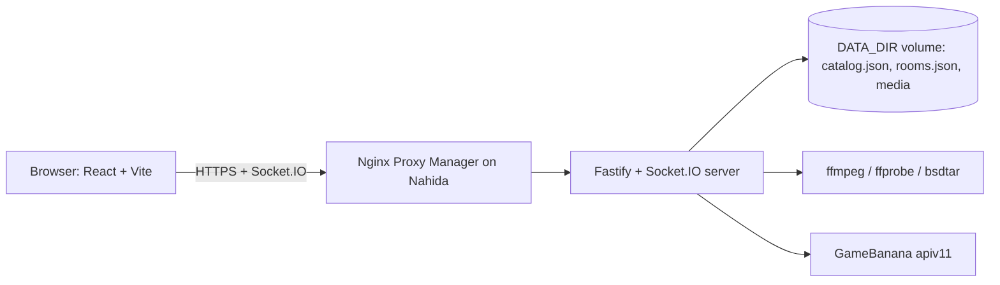

# Multiplayer Choicer Voicer: design and plan

This document is the full plan for the service. It also records the decisions that the code follows.

## 1. Goal

Multiplayer Choicer Voicer is a website for groups of friends. The players dub a Choicer Voicer pack together in the browser. Then they watch the result together, with subtitles, and vote.

The service runs as one Docker container on Nahida, behind Nginx Proxy Manager. It uses the same pattern as Fold Down Stories.

## 2. What a Choicer Voicer pack is

A pack is a folder. The Choicer Voicer Pack Creator writes this layout, and the packs on GameBanana use it too.

```text
My Pack/
├── _pack_info.ini        [data] title, subtitle, icon, authors, readme
├── icon.png              660 x 364 pack icon
├── dub_video.ogv         Theora video + Vorbis audio (the original clip)
├── _backing_track.mp3    music and effects without the voices
├── 001_Speaker.mp3       the original line (the "prompt")
├── 001_Speaker.png       a still frame for the line
├── 001_Speaker.txt       [data] caption, image, dub_timestamps, dub_characters
└── ...
```

The `.ini` and `.txt` files use the Godot `ConfigFile` format. The values are JSON-like literals. A line can have more than one timestamp. In that case, the same recording plays at each timestamp. A line can have more than one character. Captions often start with a `[Character]` tag. The subtitles remove this tag, because they show the character separately.

During the final playback, the game mutes the clip. It plays the backing track and puts each recording at its timestamp. We do the same.

## 3. Pack sources

| Source | How it works |
| --- | --- |
| GameBanana | The server crawls the "Dub Mode" category (category 44064, game 20674) with the public `apiv11` API. It keeps the metadata in `catalog.json`. The library search runs on this local copy, so it is fast. |
| GameBanana link | A player can paste a `gamebanana.com/mods/<id>` link. |
| Direct link | A player can paste a direct archive link. Only hosts on an allow list are accepted (GitHub, Dropbox, Google Drive, Discord CDN, GameBanana). This prevents server-side request forgery into the home network. |
| Upload | A player can upload an archive (`.zip`, `.7z`, `.rar`) or a pack folder. The upload uses resumable 8 MB chunks, so slow connections can continue after an error. |
| Recently used | Packs that the server already processed show in a separate tab. They start immediately. |
| Random pack from keywords | The players type keywords. The server picks a random GameBanana pack that matches one of them (see below). |

### Random pack from keywords

The random pack is a way to choose a pack, not a game mode. It works with every game mode (Versus, Cast and Chaos).

- The lobby and the results page show a shared keyword list. Every player can add and remove keywords, for example a show, a game or a character. A player can type several keywords, separated with commas. The list has a maximum of 20 keywords. Each chip shows the colour of the player who added it.
- The host presses "🎲 Random pack". The server then:
  1. finds the catalog packs that match each keyword (every word of the keyword must be in the name, the submitter or the category). Without keywords, every pack matches;
  2. removes rated packs, and mods that have no usable archive;
  3. removes the packs that the room already played or picked, and the current pack. If no other pack matches, it uses the played packs again;
  4. chooses a random keyword, then a random pack for that keyword. So each keyword has the same chance, also when one keyword matches many more packs than another;
  5. reads the files of the mod and takes the most downloaded archive between 100 KB and the download limit. A smaller archive is only a note or a link. If the mod has no such file, the server tries a different pack (up to 6 mods);
  6. starts the normal GameBanana job for that file.
- The pack card shows "Random pick for “keyword”" and how many packs match. The host can press "🎲 Another random pack" at any time, also while the pack downloads.
- Some GameBanana mods contain no Choicer Voicer pack. If the job of a random pick fails, the server marks the mod as unusable and picks another pack automatically, up to 3 times for each press of the button.
- On the results page, a new random pack becomes the next pack. The start button then shows "Play “title”".
- The room keeps the keywords and the played mods in `rooms.json`.

### Suggestions and the queue

- **Suggestions.** Every player can suggest a pack ("💡 Suggest a pack" in the "Next packs" card of the lobby and the results page). The Library opens with the GameBanana, "On this server" and "Link" tabs. Everybody sees each suggestion with its picture, its GameBanana link and the player who suggested it. The host can use it now, put it in the queue, or remove it. The player who suggested a pack can also remove it. A room has a maximum of 30 suggestions.
- **Queue.** The host can add packs to the queue ("➕ Add to the queue", or "Queue" on a suggestion). The server starts the download and the processing of each queued pack immediately, in the background (at most 2 jobs at the same time, as for all jobs). When a queued pack is ready, the browsers download its files after all the files of the current pack (see section 9). Each queue entry shows the server progress, then how much of the pack is on this device. The queue has a maximum of 10 packs.
- **Use a queued pack.** "▶ Use now" makes the queued pack the current pack. If the server has not finished it, the room waits for its job. On the results page, the host has the button "⏭ Next pack: title". It takes the first queued pack and goes back to the lobby. Using a suggestion or a queued pack on the results page always goes back to the lobby.
- **Remove from the queue.** "✕ Remove" takes the pack out of the queue. The server stops its job if no other room and no other queue needs it.
- The room keeps the suggestions and the queue in `rooms.json`. After a server restart, the server starts the jobs of the queued packs that were not ready again.

### While the server prepares a pack

- The pack card shows the name of the pack, the stage and the progress, up to 3 preview pictures, the text from GameBanana and the link "Open on GameBanana ↗". So the group can check the pack early, for example its language.
- The host has two controls:
  - **✕ Cancel** stops the download and forgets the pack. The server aborts the download, the extraction and the processing, and deletes the files of the job, when no other room or queue needs the job. For a job that failed, the button is "Dismiss".
  - **🔍 Find another pack** cancels the pack and opens the Library. After a random pick, the button is "🎲 Another random pack" and gets a new random pack instead.
- When the host chooses a different pack while a pack downloads, the server also stops the old job if nobody needs it.

The home screen and the "Upload" tab have a "Create your own Choicer Voicer pack" button. It opens [ChoicerVoicerPackCreator](https://github.com/throndir2/ChoicerVoicerPackCreator), a free Windows app that makes a pack from a video or a YouTube link.

The API endpoints that we use:

- `GET /apiv11/Mod/Index?_nPerpage=50&_aFilters[Generic_Category]=44064&_nPage=N` for the list.
- `GET /apiv11/Mod/<id>/ProfilePage` for the files and the description.
- `GET /apiv11/Mod/Categories?_idCategoryRow=44064` for the sub-categories.
- `https://gamebanana.com/dl/<fileId>` for the download.

## 4. Pack processing on the server

Chrome and Safari cannot play Theora video. Also, the still frames are large PNG files. So the server converts each pack one time and keeps the result in a cache.

Processing has two phases, so that players can start to record quickly.

1. **Phase A (fast, seconds).** Download, extract (bsdtar for zip, 7z and rar), find every folder with `_pack_info.ini`, and parse the metadata. Convert the line images to 640 px JPEG files. Copy the prompt MP3 files. Measure each prompt with ffprobe. Write `manifest.json`. The room can start to record after phase A.
2. **Phase B (slow, minutes).** Convert `dub_video.ogv` to H.264 MP4, maximum 720p, with `+faststart`. The video is necessary only for playback, so this runs while the players record.

Output layout: `DATA_DIR/media/packs/<packId>/` with `manifest.json`, `icon.jpg`, `backing.mp3`, `video.mp4` and `lines/L001.jpg|.mp3`.

All files have unique names and never change, so the server sends them with `Cache-Control: immutable`. A least-recently-used rule removes old packs when the cache is larger than `PACK_CACHE_MAX_GB`.

The server runs one video conversion at a time, because Nahida has a small CPU.

## 5. Rooms

- A player creates a room and gets a 5-character code (no 0, O, 1, I or L). The invite link is `https://<host>/join/<CODE>`.
- The player token is a random 32-byte value. The browser keeps it in `sessionStorage`. Each tab is a different player, which makes testing easy. If a player closes the tab, they can join again with the same name. They then get the same seat back if that seat is disconnected.
- The creator is the host. The host chooses the pack, the mode and the cast. Every player can add keywords for a random pack and suggest packs. Only the host can use a suggestion, change the queue or cancel a download. The host can remove players and can give the host role to a different player. If the host is away for 60 seconds, the next connected player becomes the host.
- The rooms are kept in memory and written to `rooms.json`, so a restart does not lose them. A room without connected players for 6 hours is deleted together with its recordings.

## 6. Game modes

All modes use one general model. A round has one or more **dubs**. A dub maps each line to one player.

| Mode | Dubs | Who records what | End |
| --- | --- | --- | --- |
| **Versus** | One dub for each player | Each player records all the lines | Watch each dub, then vote for the best one (you cannot vote for your own dub) |
| **Cast** | One shared dub | The host gives characters to players. "Auto-cast" balances the characters by speaking time | Watch the ensemble dub |
| **Chaos** | One shared dub | Lines are shuffled and shared equally | Watch the ensemble dub |

A line with more than one character goes to the player of the first assigned character. A setting fills missing lines with the original prompt audio (for example, the lines of a player whom the host removed). A player who joins during a Versus round can join in with a new dub. In the other modes, a late player watches. On the results page, the host can start a new round with the same pack, get a random pack from the keywords for the next round, or go back to the lobby, as many times as the group wants. A watcher can clear "I only want to watch" on the results page to take part in the next round.

The host sets two more options in the lobby. They apply to the next round and cannot change during a round.

| Option | Default | Effect |
| --- | --- | --- |
| Show the scene while recording | Off | Off: the recorder shows a default picture, not the line picture or the video. The scene stays a surprise until the playback. The progress panel does not show the line pictures either. On: the recorder shows the line picture and plays the muted scene with the original line, the take and the recording. |
| Players can go back to earlier lines | Off | Off: a player records the lines in order. "Next" is available only after a take of the current line, and "Previous" and the line list are not available. On: the player can move to any line and record it again. |

**End of the recording phase.** When a player has a take of every line, the player presses "I am done" (or "Finish" on the last line). After that, the player cannot change the lines. When every player with lines in the round is done, the server moves the room to playback automatically. Nobody can go to playback before that, not even the host. If a player leaves, the host can remove that player in the progress panel, so the others do not wait. "Back to recording" on the playback page clears the "done" marks.

## 7. Recording

- The player sees the character, the caption and the length of the original line. The picture is a default picture, or the line image when "Show the scene while recording" is on.
- "Play original" plays the prompt. When "Show the scene while recording" is on and the video is downloaded, the player sees the real scene too.
- When the player goes to another line (Next, Previous, the line list, or the `N` and `B` keys), the original line plays one time automatically, the same as "Play original". The first line of the round does not play by itself. "Record" stops the playback, and a playback that still loads does not start after a stop, a recording or a line change. "Play the original line when I go to a line" (in the Microphone card, default on, saved in the browser) turns this off.
- "Record" always starts a 1.5 s countdown. The recording then runs for exactly the length of the original line and stops automatically. It is never longer than the original line. The server removes the countdown and also cuts each take to the length of the original line.
- "Original voice while recording" (in the Microphone card, 0 to 100 %, default 30 %, saved in the browser) sets the volume of the original line during a recording. When it is above 0, the original line plays at that volume after the countdown. When the scene option is on, the muted video plays too. Echo cancellation removes the original line from the take (see below), but headphones still give the cleanest take. At 0 %, the original line does not play during a recording.
- The waveform shows the take on top of the original line on one time line, so the player can compare the timing directly. Each device pixel column shows the minimum and maximum of the samples (the peaks) and a brighter loudness (RMS) core. While the player records, the browser captures every microphone sample with an AudioWorklet and draws the live signal on top of the original line, which is shown where it plays (after the countdown).
- **Echo cancellation.** The microphone always opens with echo cancellation, with the value `"all"` (Chrome 141 and later). This also removes other sound that the computer plays, for example the "listen to this microphone" loopback of a voice changer such as Voicemod. Older browsers read the value as normal echo cancellation. "Noise suppression and automatic volume" is a separate setting.
- The take uploads immediately after "Stop". The upload tells the server the lead (the seconds from the start of the upload to the start of the original line: the countdown plus the output latency) and the volume of the original line. The server then cleans the take (`apps/server/src/util/take.ts`):
  1. **Echo of the original line.** When the original line played, the server uses it as the echo reference. It finds the delay of the copy in the take (GCC-PHAT cross-correlation, 0.5 s before to 1.5 s after the lead), measures the clock drift between the two halves of the line, estimates the echo path as a 21 ms filter (weighted so that the parts where the player speaks count less), and subtracts the estimated echo. A filter fitted on every other half second must make the other blocks quieter; if it does not (no echo, or a chance peak), the take stays as it is. Synthetic tests remove 20 to 34 dB of echo.
  2. **Timing.** The countdown is cut. The first word is where the level stays 12 dB above the measured noise floor (and within 30 dB of the loud part) for 40 ms of 60 ms. The same rule finds the first word of the original line. The take is placed so that its first word plays at the same moment as the first word of the original line (`RECORDING_OFFSET` is now 0). Everything before the first sound (0.05 s pre-roll) and after the last sound is silent.
  3. The server normalises the loudness (`loudnorm`) and stores AAC (`.m4a`), which all browsers can decode. A new take replaces the old take. A take without speech keeps the part after the countdown.
- **Match score (0 to 100).** The original game compares a take with the original line. We do the same with the waveform. The server decodes the take and the original line to 8 kHz mono, and makes a loudness envelope (one value for each 20 ms, relative to the loud part, with the silence at both ends removed). Then it compares the two envelopes:
  - **Shape:** the correlation after the take is stretched to the length of the original.
  - **Rhythm:** the correlation on the real time line, with up to 100 ms of shift.
  - **Timing:** how close the length of the take is to the length of the original.
  - Score = 100 × (0.55 × shape + 0.45 × rhythm) × (0.5 + 0.5 × timing). The length alone cannot give points, so noise or a different sentence scores low.
  - The recorder shows the score after each take (`90+` Perfect, `75+` Great, `55+` Good, `35+` OK). The line list shows the score of each line.
- Keyboard: `R` record/stop, `P` play original, `T` play my take, `N` next line (or finish on the last line), `B` previous line (only when going back is allowed).
- Every player sees the progress of the other players: a percentage bar, the line number, a "recording now" mark and a "finished" mark. A small image of the scene shows only when the scene option is on.

## 8. Playback

- Each browser plays the dub from its local copy. No audio is streamed live.
- The clocks are synchronised with a ping exchange (the lowest round trip of several samples). The host presses play. The server sends "play at server time T + 1.5 s". Each browser starts at that moment. A player who joins late starts at the correct position.
- The Web Audio API plays the backing track and every recording at an exact time. The video follows the audio clock. If the video moves away by more than 0.25 s, it is moved back.
- The subtitles show the character, the cleaned caption and the name of the player. Each player can hide the subtitles.
- The host can pause, continue, restart and select the next dub. The host sees which players are ready.
- On the results page, each player can watch any dub again locally. A player can also export a dub to MP4. The server mixes the audio with ffmpeg and adds the subtitles as a soft subtitle track.
- The results page also shows the match score. In Versus, each dub shows its average score, and the page names the best match. A tie in votes is ordered by the match score. In Cast and Chaos, the page shows the average score of each player. A line without a take counts as 0.

## 9. Downloads to the browser ("Is this possible on a website?")

Yes. A website can store large files without a download prompt. The files do not go to the Downloads folder. They go into the private storage of the site in the browser (the Cache Storage API). Other sites and the computer cannot see this storage. This is the same sandbox that streaming sites use for offline video.

- Chrome and Edge allow a site to use up to about 60% of the free disk space. Firefox allows about 10%. Safari allows about 1 GB before it asks. A typical pack is 5 MB to 300 MB after processing.
- The client calls `navigator.storage.persist()` so that the browser does not remove the files while a game runs.
- The **asset manager** in the client:
  1. downloads files in priority order: the images and prompts for my lines first, then recordings from other players, then the backing track, then the video. The files of the queued packs come last, in queue order;
  2. downloads at most 3 files at the same time;
  3. continues a failed download from the last byte with an HTTP `Range` request (important on slow or unstable connections);
  4. starts as soon as the host selects a pack, and gets each new recording of another player as soon as the server announces it;
  5. reports its progress to the server, so the room shows how ready each player is;
  6. removes files that were not used for 7 days.
- If the video is not completely downloaded when playback starts, the video streams from the server, and the audio still plays from the local copy.
- **Downloaded files panel.** A player can see and delete the stored files without the developer tools of the browser. The panel opens from the "💾 Downloaded files" button on the home page, from the 💾 button in the top bar of a room, and from "Manage downloaded files" in the lobby. The panel:
  1. tells the player that the files are in the private storage of the site in the browser, not in the Downloads folder, and that unused files go after 7 days;
  2. shows the total size, and one row for each pack (with its name, size, number of files and last use) and one row for the recordings of players;
  3. has a "Delete" button for each row and a "Delete all" button;
  4. marks the packs and recordings that the open room uses. If the player deletes them, the files download again at once, because the room needs them;
  5. has the option "Delete all downloaded files when I leave a room". The files go when the player leaves the room in the site. If the player closes the tab in a room, the files go at the next visit, unless that visit goes back into the same room (a reload).
- A delete removes the files from the Cache Storage, from the index of last use and from the memory of the asset manager. Running downloads of the deleted files stop and do not write to the cache. The preloader of an open room then requests the files of the room again. The page does not reload.
- The client remembers the name of each pack in `localStorage`, so the panel can show names. For older files, the panel asks the server for the name.

## 10. Architecture



| Part | Technology |
| --- | --- |
| Monorepo | npm workspaces: `packages/shared`, `apps/server`, `apps/web` |
| Server | Node 22, Fastify 5, Socket.IO 4, Zod, tsup |
| Client | React 19, Vite 6, Wouter, plain CSS |
| Media tools | ffmpeg, ffprobe, bsdtar (libarchive) |
| Storage | Files on one Docker volume (no database) |

## 11. Deployment

- `Dockerfile`: multi-stage build, `node:22-alpine` with `ffmpeg` and `libarchive-tools`, non-root user, `/data` volume.
- `deploy/compose.yaml`: one service, port `3090` on `192.168.50.9`, health check on `/healthz`, memory and CPU limits.
- `scripts/deploy-nahida.ps1`: builds the image locally, copies it with `docker save` and `scp`, loads it on Nahida, writes the `.env` file and starts Compose. This is the same flow as Fold Down Stories. No GitHub Actions minutes are used.
- `scripts/configure-npm.ps1`: creates the Nginx Proxy Manager proxy host for `choicervoicer.throndir.com` to `http://192.168.50.9:3090`, with WebSocket upgrades, the `*.throndir.com` certificate and forced HTTPS.
- The live site is `https://choicervoicer.throndir.com` (Cloudflare DNS → router → Nginx Proxy Manager → container).

## 12. Work plan

1. Scaffold the monorepo and the shared contracts.
2. Server: GameBanana catalog sync and search.
3. Server: pack download, extraction, phase A and phase B processing, cache.
4. Server: rooms, modes, recordings, voting, playback sync, persistence.
5. Server: resumable uploads, link import, MP4 export.
6. Client: home and join, lobby, library, cast editor, recorder with waveform, progress panel, synchronised player with subtitles, voting and results, asset manager.
7. Docker, Compose, deploy script and documentation.
8. Local checks: type check, unit tests, processing of real GameBanana packs, a browser test with two players, and a Docker build.

## 13. Known limits

- The rooms and the recordings are kept on one server. This is sufficient for groups of friends.
- Safari keeps less storage, so very large packs stream the video on Safari.
- The microphone needs HTTPS. Nginx Proxy Manager gives HTTPS. `localhost` works for development.
